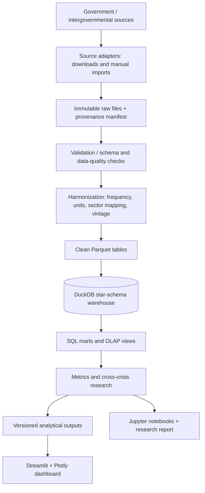

# Architecture — IndustryResilience

## Design principles
A **modular monolith** built with Python. Clear boundaries and deterministic transformations. One local/embedded analytical warehouse. The dashboard is read-only for analytical data, and never scrapes websites or trains models while handling a user request.

## End-to-end flow


## Modules and allowed dependencies
| Module | Responsibility | Consumes | Produces |
|---|---|---|---|
| `ingestion/` | source-specific fetch/import, retry, integrity capture | official endpoints, source configuration | raw originals, source manifests |
| `validation/` | schema, null, duplicate, range, time-index checks | raw/parsed inputs | quality report, validated records |
| `harmonization/` | industry concordances, units, real/nominal, calendar frequencies | validated records + mapping files | comparable time-series panel |
| `warehouse/` | DuckDB schema, incremental or idempotent loads | harmonized Parquet | fact/dimension tables |
| `metrics/` | growth, contractions, trend gaps, recovery | warehouse analytical views | measurement tables |
| `analysis/` | event comparisons, correlations, sensitivity | measurement tables | evidence tables and plots |
| `mining/` | clustering, association rules, WEKA exports, supervised experiments (when sample allows) | carefully sampled panels | reproducible model outputs |
| `visualization/` | chart specification and publication-ready figures | versioned results | plots and figures |
| `dashboard/` | read-only page navigation, interaction, source/limitation labels | published analytical outputs | web UI |

**Import direction:** low-level data/warehouse modules must not import dashboard code. Notebook calculations must call production metrics code. Pages must not contain extraction, harmonization or model training.

## Suggested repository layout
```text
industry-resilience/
  AGENTS.md                  # Codex working agreements
  README.md                  # quick start / project synopsis
  pyproject.toml, uv.lock    # reproducible environment
  configs/                  # crises, countries, industries, indicators
  data/raw/                 # originals, ignored unless allowed
  data/interim/             # parsed and quality-checked
  data/processed/           # harmonized Parquet / publishable outputs
  data/metadata/            # source manifests / data dictionary
  src/industry_resilience/
    ingestion/ validation/ harmonization/ warehouse/
    metrics/ analysis/ mining/ visualization/
    cli.py settings.py
  sql/ddl/ sql/transformations/ sql/marts/ sql/olap/
  dashboard/app.py dashboard/pages/ dashboard/components/
  notebooks/ tests/unit/ tests/integration/
  reports/figures/ docs/
  .github/workflows/ci.yml
```

## Warehouse grain and initial entities
- `dim_country(country_id, code, display_name, calendar)`
- `dim_industry(industry_id, canonical_name, classification_version, mapping_quality)`; mappings stored as separate versioned concordance table, not just name labels.
- `dim_period(period_id, frequency, start_date, end_date, fiscal_year_label)`
- `dim_indicator(indicator_id, definition, unit_family, direction, aggregation_method)`
- `dim_source(source_id, institution, dataset, table_id, url, vintage, retrieved_at, sha256, license)`
- `dim_shock(shock_id, category, onset_date, observation_end, status, methodological_notes)`
- `fact_observation(country_id, industry_id nullable, period_id, indicator_id, source_id, value, measurement_unit, price_basis, base_year)`
- `bridge_shock_period(shock_id, country_id, period_id, exposure_stage)`
- `fact_shock_response(shock_id, country_id, industry_id, metric_id, value, baseline_period_id, method_version, coverage_status)`

**Data keys:** uniqueness checked at the true observation grain, including source vintage, price basis and frequency. An event is a *label/window*, not a property attached indiscriminately to all observations. Preserve revised source vintages. Add a `dim_metric` or equivalent controlled metric registry before materializing `fact_shock_response`.

## Scientific integrity rules
- No comparisons between unmatched currencies, price bases, periods or industry definitions.
- No artificial values in results. Synthetic values permitted only in labeled unit-test fixtures.
- Keep 2011–12 and 2022–23 Indian GDP/GVA base series distinct until an official comparable back-series is validated.
- US real industry chain-type measures may not be additive at detailed industry levels: avoid summing chain-dollar values as if ordinary additive currency amounts.
- Do not conflate India fiscal years with US calendar years.
- No `recovered` label without a verified post-trough crossing; incomplete observations are right-censored.
- Every dashboard number must resolve to source identifiers and a method version.

## Technical operations
Use `uv` for installation and lockfile, `ruff` for lint/format, `pytest` for checks, optional `mypy` for typed core modules, GitHub Actions for CI. Executable commands must be added only when actual modules exist; README never claims unimplemented commands work.

## Lightweight quality gates
Phase 00: clean install, imports, empty-state app, database health check, CI. Phase 01: at least one real official extract with checksum and row counts. Phase 02: sector/time mapping review and quality report. Phase 03: SQL grain/uniqueness tests. Phase 04: metric unit tests and manual spot checks. Phase 05: sample sufficiency check. Phase 06: chart-to-source lineage review. Phase 07: complete rebuild and release.
