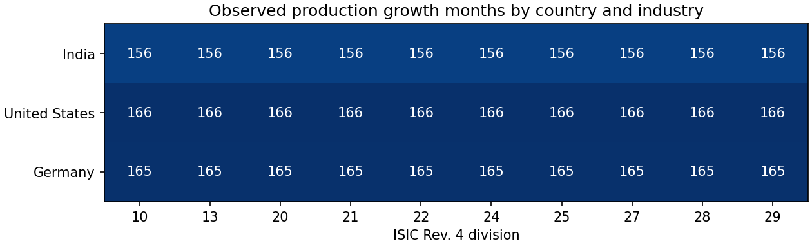
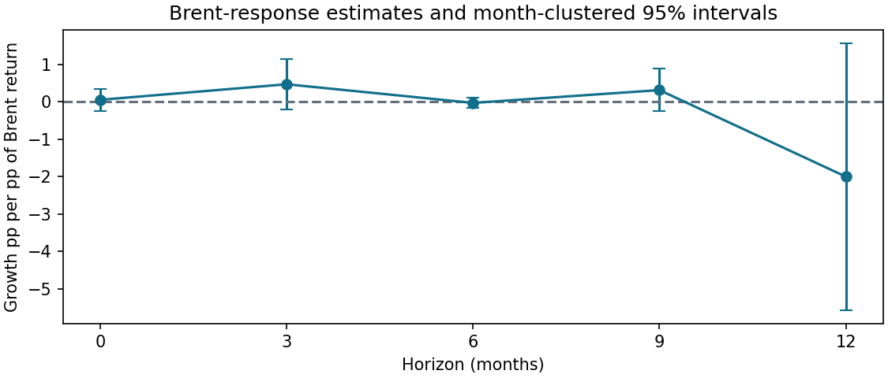

# Manufacturing responses across seven historical windows

## Questions and evidence

Can one industry retain its relative position across shocks? Do its growth shifts resemble those of the same industry abroad? Do pre-shock production features improve historical slowdown classification over a majority baseline? The analysis investigates these questions using ten approximate ISIC Rev. 4 manufacturing divisions across India, the United States and Germany.

| Country | Observed months per division | Observed period | Measurement |
| --- | ---: | --- | --- |
| India | 156 | Apr 2013–Mar 2026 | MoSPI IIP published YoY growth, republished by Measure of India |
| United States | 166 | Jan 2013–Oct 2026 | Federal Reserve G.17 ISIC Rev. 4 NSA index, base 2017 |
| Germany | 165 | Jan 2013–Sep 2026 | Eurostat sts_inpr_m NACE Rev. 2 NSA index, base 2021 |

All 30 country–industry panels contain observations, totaling **4,870 monthly production values**. The expanded case grid has **180 full-window, 30 partial, and zero wholly unavailable cases**. Twenty partial cases still meet the six-month baseline and impact gate. India has one of eight impact months for each division in the 2026 tariff regime, so its ten cases have no calculated shift. Germany has seven of eight impact months. The ten India cases for the oil collapse have 15 of 18 baseline months. [Source manifest](source_manifest.json) · [Event coverage](event_coverage.json) · [Industry crosswalk](../../research_expansion/config/industry_isic4.csv)

## Observed findings

- **US basic metals reversed rank.** It ranked 10th of 10 in the 2014–16 oil collapse with a **−7.16 pp** growth shift and second in the 2022 energy surge with **+10.33 pp**. The two windows have different starting points and economic conditions.
- **Chemicals diverged in 2022.** Relative to 2019, mean YoY growth shifted **−8.21 pp in Germany**, **+3.98 pp in the US**, and **+4.06 pp in India**. Germany's chemicals growth reached the three-month normalization criterion in December 2023, compared with March 2023 for India and the US. This criterion concerns growth rates. Energy costs, supply disruptions and differences in industry composition could all matter, but the comparison cannot isolate their effects.
- **Motor vehicles diverged during the 2025 tariff window.** Observed shifts were **+3.76 pp in India**, **−0.51 pp in the US**, and **−5.01 pp in Germany**. These are changes during the policy window. The exposure analysis requires matched customs duties and import values by product and partner, with a verified industry mapping. The run had no such export, and DataWeb's API requires credentials. [Shock profiles](models/shock_profiles.json) · [USITC DataWeb API guide](https://www.usitc.gov/applications/dataweb/api/dataweb_query_api.html)
- **German AI adoption rose within the same survey definition.** The share of surveyed German enterprises with 10 or more workers using AI rose from **10.56% in 2021** to **25.97% in 2025**. Four annual observations are available. This aggregate covers the survey's sectors and supports no India–US comparison or manufacturing-division claim. [AI observations](models/ai_transition.json) · [Eurostat survey](https://ec.europa.eu/eurostat/statistics-explained/index.php?title=Use_of_artificial_intelligence_in_enterprises)

## Methods and evaluation

The event profiles use the [seven configured windows](../../research_expansion/config/event_windows.csv). For US and Germany, YoY growth is 100 times the ratio of production indexes 12 calendar months apart minus 100. India uses the published rate directly. The profile subtracts mean baseline YoY growth from mean impact YoY growth. It also reports volatility, lowest observed growth, negative-month share, comparable follow-up shifts and the third consecutive observed follow-up month at or above baseline growth. At least six baseline and six impact months are required. The two-month post-tariff period in 2020 is shown with coverage, with the follow-up shift withheld. Partial cases can average different subsets of the same calendar window. The two original 12-month studies remain available under their original definitions.

The dynamic model regresses future YoY growth at five horizons on the same month's Brent log return, previous-month industry growth and country–industry fixed effects. Standard errors are clustered by calendar month. Each horizon uses at least 153 observed months across 30 groups. **All five 95% intervals cross zero.** Month clustering accounts for common contemporaneous exposure. Overlapping growth measures, serial dependence and omitted variables limit inference. The World Bank European gas series is recorded as a separate context series in nominal USD/MMBtu.

| Algorithm | Sample | Evaluation or output |
| --- | ---: | --- |
| PCA | 150 cases | First three components explain 40.4%, 32.5% and 18.8% of standardized profile variance |
| K-Means | 150 cases | Three clusters, silhouette 0.855 |
| Ward hierarchical | 150 cases | Silhouette 0.855 and adjusted Rand agreement of 1.000 with K-Means in this specification |
| K-nearest neighbors | 120 cases | 73.3% grouped accuracy vs 68.3% majority baseline |
| Apriori | 200 cases | 60 frequent itemsets at 12% minimum support, with support, confidence and lift in the rule export |
| Random Forest | 120 cases | 76.7% grouped accuracy vs 68.3% majority baseline |
| Logistic regression | 120 cases | 75.0% grouped accuracy vs 68.3% majority baseline |
| Isolation Forest | 150 cases | 15 flagged profiles with a 10% contamination setting |

Classification uses pre-shock mean, standard deviation and negative-month share plus known country, industry and event identifiers. Preprocessing is fitted inside each of three country–industry group folds. The four eligible historical shocks occur across folds, so this exercise does not test generalization to an unseen shock. PCA, clustering and outlier detection use observed outcome features for description. Fifty eligible cases lack follow-up windows and do not enter those complete-feature models. The 2021 YoY rebound and related extremes can dominate distance-based results. [Model exports](models/) · [Executed notebooks and status](notebook_runs/)

The event analysis adapts resistance and recovery concepts from regional resilience research. The dynamic model follows the horizon structure of local projections and treats Brent as a mixed demand-and-supply signal. Harvard's harmonization work and UNIDO industry statistics provide research context. [Martin (2012)](https://doi.org/10.1093/jeg/lbr019) · [Martin et al. (2016)](https://doi.org/10.1080/00343404.2015.1136410) · [Jordà (2005)](https://doi.org/10.1257/0002828053828518) · [Kilian (2009)](https://doi.org/10.1257/aer.99.3.1053) · [Harvard Atlas](https://atlas.hks.harvard.edu/trade-data-methodology/) · [UNIDO INDSTAT](https://stat.unido.org/data/database-descriptions)

## Limitations

The 2021 supply-chain window overlaps COVID-related disruption and its follow-up overlaps the energy surge. Brent measures global crude prices and the World Bank gas series measures a distinct commodity. A 2019 baseline for the energy surge avoids pandemic rebound but is farther from the event. The 2018 tariffs, 2025 tariff wave and revised 2026 regime differ in scope and timing, including policy changes in February and July 2026. The date windows identify observed periods and do not measure tariff exposure or isolate causal effects. Source classifications, revision practices and latest published months differ by country. [Research timelines](../../research_expansion/docs/09_EXPANDED_EVENT_TIMELINES.md) · [Policy chronology](https://www.everycrsreport.com/reports/R49481.html) · [World Bank Pink Sheet](https://www.worldbank.org/en/research/commodity-markets)
